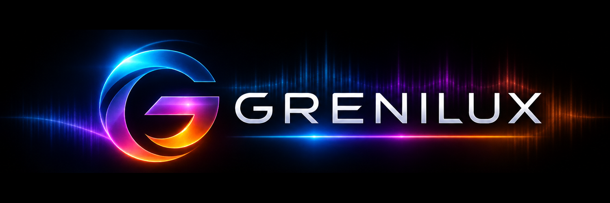

<p align="center">
  
</p>

<p align="center">
  <a href="https://buymeacoffee.com/j3hst3r"></a>
</p>

**Grenilux** is a real-time, audio-reactive colour visualizer. Put it on a track (a guitar, for example) and it turns what you play into colour and motion. Your audio passes through unchanged.

- **Six views:** Wavelength, Spectrum, Bars, Circles, Fluid and Particles
- **Colour that follows the music:** by note, by frequency, or both, with your own palettes in the colour editor
- **Presets** that are saved with your project
- **Perform window:** fullscreen on any monitor, for live shows
- **Windows standalone app:** visualize your audio interface input without a DAW


## Screenshots
Fluid


Spectrum


Wave


## Demo Video

[[Watch the video](https://youtu.be/x0ucB4NfLFM)]


New to Grenilux? Read the [User Guide](USER_GUIDE.md).

## Download

Get the latest version from the [**Releases**](../../releases/latest) page.

| Platform | File | Contents |
|---|---|---|
| macOS 11 or later (Apple Silicon and Intel) | `Grenilux-<version>-macOS-VST3.zip` | VST3 plugin |
| Windows 10/11, 64-bit | `Grenilux-<version>-Windows-x64.zip` | VST3 plugin and standalone app |

## Install on macOS

1. Unzip the download and copy `Grenilux.vst3` to `~/Library/Audio/Plug-Ins/VST3/`. In Finder, choose **Go → Go to Folder…** and paste that path.
2. Grenilux isn't notarized by Apple yet, so macOS blocks it until you clear its "downloaded from the internet" flag. Open **Terminal** and paste:

   ```
   xattr -dr com.apple.quarantine ~/Library/Audio/Plug-Ins/VST3/Grenilux.vst3
   ```

   Keep the `-dr`: the `r` clears every file inside the plugin, not just the folder. The command prints nothing when it works.
3. In Ableton Live, open **Preferences → Plug-Ins**, hold **Option** and click **Rescan**. Grenilux appears under **Plug-Ins → VST3 → Grenilux**.

To check that the flag is gone, run `xattr -lr ~/Library/Audio/Plug-Ins/VST3/Grenilux.vst3`. It should print nothing that contains `com.apple.quarantine`.

## Install on Windows

1. Unzip the download.
2. **Plugin:** copy the `Grenilux.vst3` folder to `C:\Program Files\Common Files\VST3\`. Windows asks for administrator permission.
3. In Ableton Live, open **Preferences → Plug-Ins**, turn on **Use VST3 Plug-In System Folders**, and click **Rescan**.
4. **Standalone app:** run `Grenilux.exe`. It needs no installation, so you can keep it anywhere.
   - Choose your audio interface under **DEVICE** and the input your instrument is plugged into under **INPUT**.
   - **Monitor** is off by default, so the app makes no sound and can't cause feedback.
   - **F11** switches to fullscreen.

The Windows files carry a self-issued signature, not one from a certificate authority, so Windows may say "Unknown publisher". SmartScreen may also warn: click **More info → Run anyway**.

## Support

Grenilux is free. If you enjoy it, you can support its development:

<a href="https://buymeacoffee.com/j3hst3r"></a>

## License

Grenilux is free software under the [GNU Affero General Public License v3.0](LICENSE). Its source code is attached to each release (`Grenilux-<version>-source.zip`).
