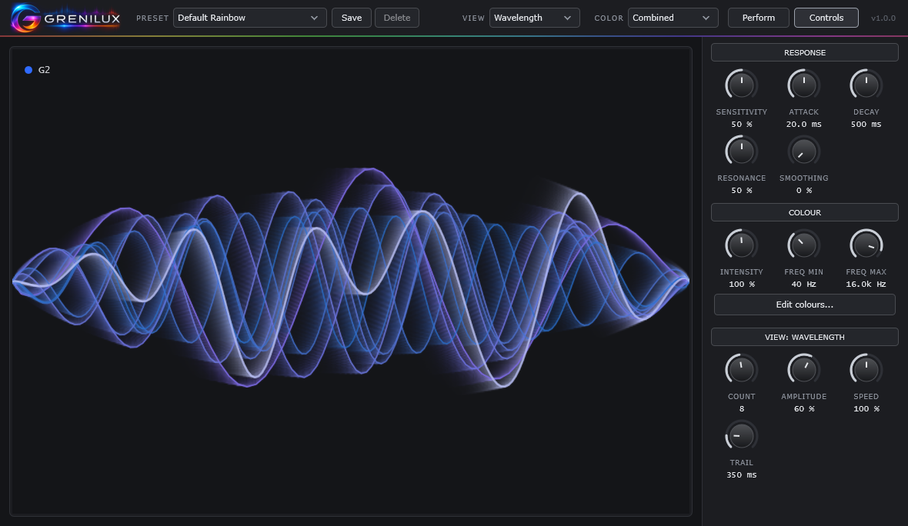
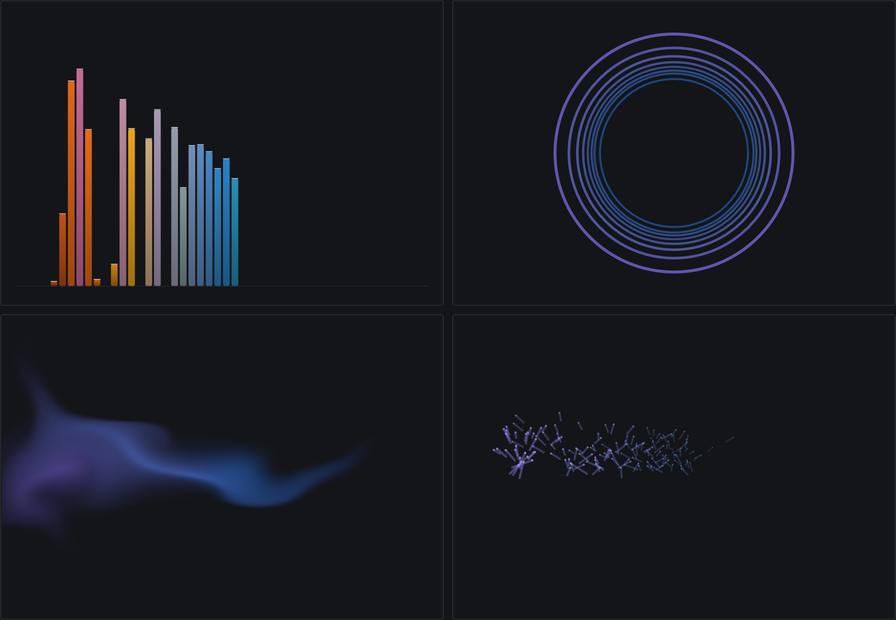
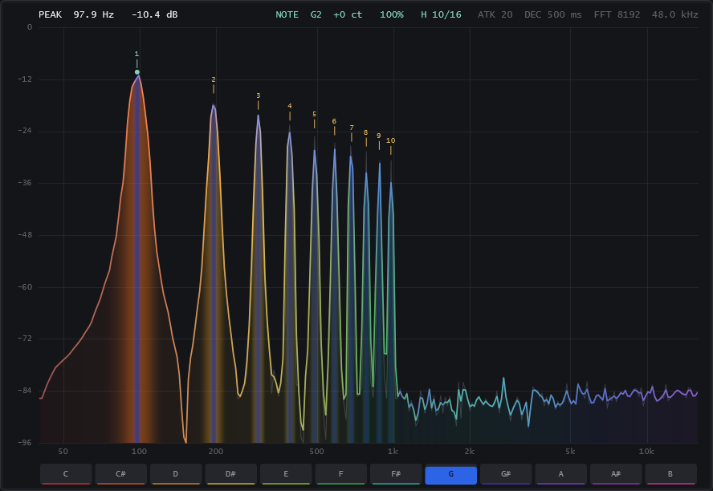
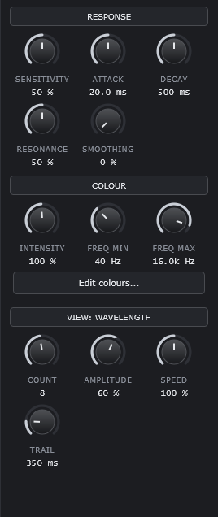
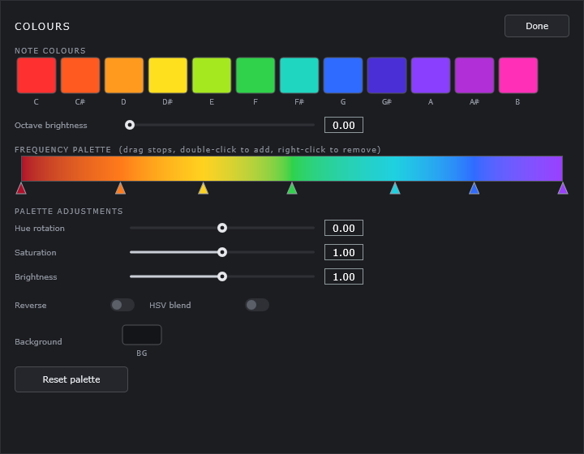
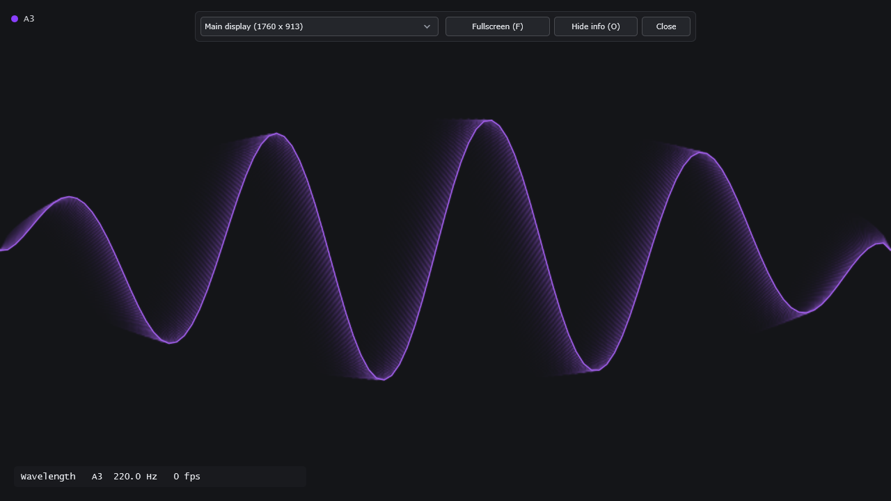

# Grenilux User Guide

Grenilux turns the sound of your instrument into colour and motion. It only *listens*: your audio passes through unchanged, so it's safe to leave on a track while you record or play live.

This guide explains every button, menu, knob and key. You don't need to read it in order.

- [Quick start](#quick-start)
- [The main window](#the-main-window)
- [The six views](#the-six-views)
- [The Controls panel](#the-controls-panel)
- [Colour modes](#colour-modes)
- [The colour editor](#the-colour-editor)
- [Presets](#presets)
- [Perform mode](#perform-mode)
- [The Windows standalone app](#the-windows-standalone-app)
- [Tips for live use, streaming and smooth visuals](#tips-for-live-use-streaming-and-smooth-visuals)
- [Troubleshooting](#troubleshooting)

Grenilux is a VST3 plugin for macOS and Windows. On Windows there is also a standalone app that works without a DAW (your recording software). Not installed yet? See the install steps in the [README](README.md#download).

---

## Quick start

1. **Put it on a track.** Add Grenilux as an audio effect on the track you want to see, for example your guitar track. Anywhere in the effect chain works; put it last if you want it to react to your amp and effects too.
2. **Open it.** Open the plugin window as you would for any effect.
3. **Play.** The INPUT meter at the bottom left moves and the canvas comes alive. If you're playing live, the track has to be armed or monitoring so sound reaches the plugin.
4. **Pick a look.** Choose a **Preset** at the top left, or pick a **View** and a **Color** mode yourself.
5. **Go big (optional).** Click **Perform** for a clean window that can fill a second screen.

No DAW? On Windows, run `Grenilux.exe` and see [The Windows standalone app](#the-windows-standalone-app).

---

## The main window



You can resize the window by dragging its corner. The smallest size is 900 × 560, and it opens at 1180 × 720.

### The top bar

From left to right:

| Control | What it does |
|---|---|
| **Logo** | Just the logo. It isn't a button. |
| **PRESET** menu | Loads a complete look: view, colour mode, every knob and all colours. Shows **Custom** as soon as you change anything. See [Presets](#presets). |
| **Save** | Saves the current look as your own preset. |
| **Delete** | Deletes the preset of yours that is currently loaded. It's greyed out for built-in presets. |
| **VIEW** menu | Chooses one of the six visuals: Wavelength, Spectrum, Bars, Circles, Fluid, Particles. See [The six views](#the-six-views). |
| **COLOR** menu | Chooses how colours are picked: Note, Frequency or Combined. See [Colour modes](#colour-modes). |
| **Perform** | Opens (or closes) the Perform window for shows and streams. The button stays lit while that window is open. See [Perform mode](#perform-mode). |
| **Controls** | Shows or hides the knob panel on the right. Hide it to give the visuals the whole window. |
| **Version** | The version you have installed, for example `v1.0.0`. |

### The canvas

The big dark area is where the visuals are drawn. It doesn't react to clicks; everything is controlled from the top bar and the Controls panel.

### The status strip

The strip along the bottom tells you whether Grenilux is hearing you.

| Item | What it tells you |
|---|---|
| **INPUT** meter | How loud the incoming sound is. The number beside it is the level in dB (decibels); `-inf dB` means silence. |
| **Signal / No signal / Clipping** | **Signal** (green): sound is arriving. **No signal** (amber): nothing is arriving. **Clipping** (red, and the meter turns red): the sound is hitting the maximum level, so turn your input down a little. |
| **NOTE** | The note Grenilux hears, with its octave and pitch, for example `NOTE G2  98.0 Hz`. It shows `--` when there's no clear single note (silence, noise, or a dense chord). It works best for single notes from a low A (55 Hz) up to about 1600 Hz. |
| **Analysis: active / waiting for audio** | **active** means Grenilux is listening and analysing. **waiting for audio** means your DAW isn't sending it any sound right now, often because playback is stopped or the track is switched off. |
| **dropped …** | Only appears if your computer was too busy to analyse some of the sound. Your audio is not affected, only the visuals. If the number keeps climbing, see [Low frame rate](#the-visuals-stutter-or-the-fps-is-low). |
| **fps** | Frames per second: how smoothly the visuals are being drawn. Around 60 is ideal. |
| **kHz** | The sample rate of your project, for example `48.0 kHz`. |

---

## The six views

Pick a view with the **VIEW** menu. Low notes always appear on the left (or as the largest shapes) and high notes on the right.

| View | What you see | Good for |
|---|---|---|
| **Wavelength** | Flowing waves, one per strong tone in your sound: long, slow waves for bass and short, fast ones for treble. A brighter line shows them all added together. The note you're playing is shown at the top left. | The default. Melodies, single notes, clean chords. |
| **Spectrum** | A detailed graph of your sound, low to high, with readouts. | Checking what Grenilux hears. See below. |
| **Bars** | Classic level bars, low to high. | Full mixes, drums, anything rhythmic. |
| **Circles** | Steady rings for the tones that are ringing (large rings for bass, small for treble), plus rings that burst outward every time you hit a new note. | Rhythm playing, picking, percussive parts. |
| **Fluid** | Soft clouds of colour that drift and swirl, stirred harder the louder you play. | Ambient, slow, sustained sounds. |
| **Particles** | Sparks that fly from wherever your sound has energy, with a burst on every new note. | Energetic playing, solos. |



*Top: Bars and Circles. Bottom: Fluid and Particles.*

### Reading the Spectrum view



The Spectrum view is more of a meter than a show. It's handy for checking your signal:

- **The curve** shows how much sound there is at each pitch, from low (left) to high (right). Taller means louder.
- **PEAK** (top left) is the strongest pitch right now and how loud it is.
- **NOTE** (top centre) is the detected note, how many cents sharp or flat it is (100 cents = one semitone), and how sure Grenilux is, as a percentage. **H 10/16** means it found 10 of the note's first 16 overtones.
- **The small numbers above the peaks** mark those overtones: 1 is the note itself, 2 is an octave above, and so on.
- **The readout at the top right** repeats your Attack and Decay settings, and shows the analysis detail and sample rate.
- **The twelve boxes along the bottom** (C to B) light up in each note's own colour as that note rings.

---

## The Controls panel



Click **Controls** in the top bar to show or hide the panel. It has three sections: **RESPONSE**, **COLOUR**, and one for the current view.

**Using the knobs**

- **Drag** a knob up or right to turn it up, down or left to turn it down.
- **Double-click** a knob to put it back to its default.
- **Click a section title** (for example RESPONSE) to fold that section away, and click again to bring it back.
- If the window is too small to show everything, the panel scrolls.
- Every knob can also be automated from your DAW, like any other plugin parameter.

### RESPONSE: how the visuals react to your playing

| Knob | Range | Default | What it does | Tip |
|---|---|---|---|---|
| **Sensitivity** | 0–100 % | 50 % | How strongly Grenilux reacts to your level. Higher makes quiet playing show up more. | Visuals too faint? Turn it up. Everything maxed out and blurry? Turn it down. |
| **Attack** | 1–200 ms | 20 ms | How quickly the visuals light up when a sound starts. | Low for snappy, punchy picking. High for a soft fade-in. |
| **Decay** | 20–5000 ms | 500 ms | How long the visuals take to fade once a sound stops. | Turn Decay up for long dreamy trails; turn it down for tight, rhythmic visuals. |
| **Resonance** | 0–100 % | 50 % | Stretches or shortens the fade set by Decay: a quarter as long at 0 %, unchanged at 50 %, four times as long at 100 %. Low notes always ring a little longer than high ones, like a real string. | Think of it as "sustain". Push it up for a glow that hangs in the air. |
| **Smoothing** | 0–100 % | 0 % | Blurs the picture across neighbouring pitches, so sharp spikes become soft, wide shapes. | Leave at 0 for crisp detail. Raise it for a gentler look, especially in Bars and Fluid. |

### COLOUR

| Knob | Range | Default | What it does | Tip |
|---|---|---|---|---|
| **Intensity** | 5–200 % | 100 % | How bright quiet sounds appear. Above 100 %, soft sounds glow more. Below 100 %, only the loud parts stand out. | Raise it for a rich, full picture. Lower it for more contrast between soft and loud. |
| **Freq Min** | 20–1000 Hz | 40 Hz | The lowest pitch shown, at the left edge. | Raise it to about 70 Hz for guitar, so the picture isn't half empty. |
| **Freq Max** | 1000–20 000 Hz | 16 000 Hz (shown as `16.0k Hz`) | The highest pitch shown, at the right edge. | Lower it to about 5000 Hz for guitar or bass, to spread your notes across the whole canvas. |
| **Edit colours…** | | | Opens [the colour editor](#the-colour-editor). | |

Freq Min and Freq Max also stretch the colours: the whole rainbow always runs from Freq Min to Freq Max. (Hz, or hertz, is how pitch is measured: low numbers are bass, high numbers are treble.)

### VIEW: settings for the view you're looking at

This section changes when you change the view. Its title shows which view it belongs to, for example **VIEW: WAVELENGTH**.

**Wavelength**

| Knob | Range | Default | What it does | Tip |
|---|---|---|---|---|
| **Count** | 1–16 | 8 | The most waves shown at once. | 1–3 for a clean look on single notes; more for rich chords. |
| **Amplitude** | 0–100 % | 60 % | How tall the waves are. | Turn it up to fill the screen. |
| **Speed** | 0–200 % | 100 % | How fast the waves travel. 0 freezes them in place. | Slow it down for calm music. |
| **Trail** | 0–2000 ms | 350 ms | How long each wave leaves a glowing after-image. 0 turns trails off. | Long trails look silky; no trails look sharp and precise. |

**Spectrum**

No settings. The panel says "No settings for this view". The RESPONSE and COLOUR knobs still apply.

**Bars**

| Control | Range | Default | What it does | Tip |
|---|---|---|---|---|
| **Count** | 8–128 | 48 | How many bars. | Few, chunky bars for a retro look; many for fine detail. |
| **Bar Mirror** (switch) | on / off | off | Bars grow up *and* down from a centre line instead of up from the bottom. | Looks great fullscreen. |
| **Bar Peak Hold** (switch) | on / off | on | A small marker stays at each bar's highest point for half a second, then falls. | Turn it off for a cleaner look. |

**Circles**

| Knob | Range | Default | What it does | Tip |
|---|---|---|---|---|
| **Count** | 4–64 | 24 | The most expanding rings on screen at once. When it's full, the oldest ring makes way for a new one. | Raise it for fast playing. |
| **Decay** | 200–5000 ms | 1500 ms | How long each expanding ring lasts before it fades out. | Long for slow, ripple-on-a-pond rings; short for quick pulses. |

**Fluid**

| Knob | Range | Default | What it does | Tip |
|---|---|---|---|---|
| **Flow** | 0–200 % | 100 % | How fast the colour drifts and swirls. 0 keeps it still. | Lower it for a slow, smoky feel. |
| **Persistence** | 200–5000 ms | 1500 ms | How long colour lingers before fading. | Turn it up for thick clouds that build as you play. |

**Particles**

| Knob | Range | Default | What it does | Tip |
|---|---|---|---|---|
| **Count** | 100–4000 | 1500 | The most particles on screen at once. | More looks fuller but is harder work for your computer. |
| **Trail** | 0–100 % | 50 % | How long a streak each particle draws behind it. | 0 gives dots; high values give shooting stars. |

---

## Colour modes

The **COLOR** menu in the top bar decides where colours come from.

| Mode | How it colours things | Try it when |
|---|---|---|
| **Note** | Every note name has its own colour: every C is red, every G is blue, and so on, in every octave. Sound that doesn't belong to a clear note (pick noise, hiss, dense chords) is shown in neutral grey. | You want to *see* which notes you play. Great for melodies and single lines. |
| **Frequency** | Colour follows pitch height like a rainbow: bass is red, the middle is yellow and green, treble is blue and violet. It doesn't matter which note it is. | Full mixes, drums, noisy or heavily distorted sounds. Always colourful. |
| **Combined** (default) | The rainbow from Frequency mode, tinted towards the colour of the note you're playing. | Everyday use. You get the best of both. |

In Combined mode, when Grenilux can't hear a clear note, the picture simply looks like Frequency mode.

---

## The colour editor

Click **Edit colours…** in the COLOUR section. The editor opens over the canvas. Changes show immediately, so play while you tweak. Click **Done** to close it.



| Part | What you can do |
|---|---|
| **NOTE COLOURS** | Twelve squares, C to B. Click one to open a colour picker and choose that note's colour. These are used in Note and Combined modes. |
| **Octave brightness** (0–1, default 0) | At 0, a note has the same colour in every octave. Turn it up and high octaves get brighter while low octaves get darker. |
| **FREQUENCY PALETTE** | The rainbow strip used in Frequency and Combined modes: bass on the left, treble on the right. The small triangles under it are colour markers. |
| | **Click** a triangle to change its colour. |
| | **Drag** a triangle left or right to move it. |
| | **Double-click** the strip to add a new marker. |
| | **Right-click** a triangle to remove it. At least two always stay. |
| **Hue rotation** (−180 to 180, default 0) | Shifts every colour of the frequency palette around the colour wheel. A quick way to get a completely different mood. |
| **Saturation** (0–2, default 1) | How vivid the frequency palette is. 0 is grey; above 1 is extra vivid. |
| **Brightness** (0–2, default 1) | Makes the frequency palette darker or brighter. |
| **Reverse** | Flips the palette, so treble takes the bass colours and bass takes the treble colours. |
| **HSV blend** | Changes how colours mix between two markers. Off: a straight mix. On: the mix travels around the colour wheel, which gives more vivid in-between colours. |
| **Background** | Click the square to choose the canvas background colour. |
| **Reset palette** | Puts *all* colours back to the originals: note colours, the frequency palette, the sliders and the background. |
| **Done** | Closes the editor. |

Double-click any slider to return it to its default. Hue rotation, Saturation, Brightness, Reverse and HSV blend change the frequency palette only, not the twelve note colours.

Your colours are part of the look: they're saved in presets and with your DAW project.

---

## Presets

A preset stores the whole look: the view, the colour mode, every knob in the Controls panel, and all your colours.

### Built-in presets

| Preset | What you get |
|---|---|
| **Default Rainbow** | Everything at its starting values: Wavelength view, Combined colours. |
| **Guitar Notes** | Wavelength view in Note colours, zoomed to the guitar's range, with a longer ring and brighter high octaves. |
| **Deep Spectrum** | Mirrored bars across the full range in deep blues. |
| **Electric Neon** | Fast, vivid particles in neon pink, purple, blue and green. |
| **Soft Aurora** | Slow, soft fluid in aurora greens and violets. |
| **High Contrast** | Circles in fully saturated note colours on a black background. |

### Using presets

- **Load:** pick a name from the **PRESET** menu. Built-in presets come first; yours appear below under **User presets**, in alphabetical order.
- **Custom:** as soon as you change anything, the menu shows **Custom**. Nothing is lost; it just means "not saved as a preset yet".
- **Save:** click **Save**, type a name, and press **Save** (or Enter). Saving with the name of one of your own presets replaces it. You can't use the name of a built-in preset or the name "Custom".
- **Delete:** load one of your own presets, click **Delete**, and confirm. This can't be undone. Built-in presets can't be deleted.

### Where presets are stored

Each preset is a small file ending in `.grenilux-preset.json`.

| System | Folder |
|---|---|
| **Mac** | `~/Library/Application Support/Grenilux/Grenilux/Presets` |
| **Windows** | `%APPDATA%\Grenilux\Grenilux\Presets` |

To get there on a Mac, choose **Go → Go to Folder…** in Finder and paste the path. On Windows, paste it into the address bar of File Explorer.

You can back these files up or copy them to another computer. Grenilux re-reads the folder every time you open the PRESET menu, so new files show up straight away. The plugin and the Windows standalone app share the same folder.

### Your look is saved with your project

You don't have to save a preset to keep your look. When you save your DAW project, Grenilux stores everything inside it: view, colour mode, knobs and colours. Reopen the project and it looks the same.

---

## Perform mode

The Perform window shows only the visuals, with no knobs or borders. Use it on a second monitor, a projector, or as a source for your stream.



### Opening it

Click **Perform** in the top bar. A borderless window opens in the middle of your main screen. It always shows the same view and colours as the main window, so you keep controlling the look from there.

### The controls bar

Move the mouse over the Perform window and a small bar appears at the top:

| Control | What it does |
|---|---|
| **Screen menu** | Chooses which monitor to use, for example "Main display (1920 x 1080)" or "Display 2 (…)". The window jumps to that screen. |
| **Fullscreen (F)** | Fills the chosen screen. The button then reads **Exit fullscreen (Esc)**. |
| **Show info (O)** | Shows a small info box at the bottom left with the view name, the detected note and the fps. Click again (**Hide info**) to remove it. |
| **Close** | Closes the Perform window. |

The bar and the mouse pointer hide by themselves after about 2.5 seconds without mouse movement, so they stay out of your show. Move the mouse to bring them back.

### Keys and mouse

Click the Perform window once first so that it receives your key presses.

| Key or action | What happens |
|---|---|
| **F** | Fullscreen on / off |
| **Double-click** | Fullscreen on / off |
| **Esc** | Leaves fullscreen |
| **O** | Info box on / off |
| **Ctrl+W** (Windows) / **Cmd+W** (Mac) | Closes the Perform window |
| **Move the mouse** | Shows the controls bar |
| **Drag** (when not fullscreen) | Moves the window |

### Good to know

- **Closing the plugin window doesn't close the Perform window.** You can tidy away the plugin window and the show goes on. The Perform window closes when you click **Close**, press Ctrl/Cmd+W, click **Perform** again in the plugin, remove Grenilux from the track, or close the project.
- **If you unplug the monitor it's on,** the Perform window moves to your main screen within about a second, and stays fullscreen if it was fullscreen.
- **While fullscreen it stays on top of other windows,** so taskbars don't cover it. On a Mac, the menu bar may stay visible if you go fullscreen on the main display; use a second display for a completely clean picture.
- **It starts fresh each time:** windowed, on the main screen, with the info box off.
- The window's size isn't adjustable when it isn't fullscreen. It opens at a little over half the screen.

---

## The Windows standalone app

`Grenilux.exe` is Grenilux without a DAW: plug your instrument into your audio interface and watch, or let it follow the music your computer is playing (see [System audio](#system-audio-visualize-the-music-your-computer-plays)). It's Windows only. Everything described above works the same; the app just adds an **audio bar** at the top for choosing where the sound comes from.

### The audio bar

| Control | What it does |
|---|---|
| **DEVICE** | The audio interface or microphone to listen to, or, under the **System audio** heading, what your computer is playing. If the one you chose is unplugged, it stays in the list marked **(disconnected)**. |
| **Device settings…** | Opens a small window for the driver type, sample rate and buffer size. Most people never need it. Change these only if your interface needs a particular setting. |
| **INPUT** | Which input of the device to use. `1: …`, `2: …` are single inputs; `1+2 (stereo)` is a stereo pair. For a guitar plugged into input 1, choose `1`. |
| **Start / Stop** | **Stop** makes the app let go of your audio device (useful if another program needs it). **Start** begins listening again. |
| **Detect notes** | On: Grenilux finds the note you're playing. Off: the colours follow frequency, which suits music. See [Detect notes](#detect-notes). |
| **Monitor** | Off (the default): the app is completely silent. On: you hear the input through your computer's default playback device. See the warning below. Greyed out for System audio. |
| **LEVEL** | The input level, with one bar per input (two for a stereo pair) and the level in dB. It turns red if the input is too loud. |
| **Status line** | Tells you what's going on. See the next table. |

**About Monitor and feedback:** with Monitor on, a microphone near your speakers will howl. Use headphones, or leave Monitor off and listen to your instrument the way you normally do (your amp, or your interface's direct monitoring). Grenilux doesn't need Monitor to work.

### Status messages

| Message | What it means | What to do |
|---|---|---|
| *Device name*, input 1 - 48000 Hz, 256 samples. | All good. Grenilux is listening to that device and input. The numbers are the sample rate and buffer size. | Play! |
| … **Monitor unavailable (…)** | Listening works, but the sound can't be played back, usually because there is no playback device. | Check your speakers or headphones in Windows sound settings, or turn Monitor off. |
| **Stopped.** | You pressed Stop. | Press **Start**. |
| **No audio input device found.** | Windows has no microphone or audio interface to offer. | Plug in your interface. Grenilux starts using it as soon as it appears. |
| **No working audio input device found (…)** | An input is listed but it doesn't work. | Plug in your interface, or check its driver. |
| *Device* **is not connected. Waiting for it to return.** | The device you chose last time isn't plugged in. | Plug it in, or choose another under DEVICE. |
| *Device* **was disconnected. Waiting for it to return.** | The device was unplugged or switched off while running. | Plug it back in. Grenilux reconnects by itself. |
| *Device* **stopped (…). Retrying.** / **could not be reopened (…). Retrying.** | The device stopped delivering sound. Grenilux keeps trying every second. | Wait a moment. If it doesn't recover, replug the device or press Stop, then Start. |
| **Can't open** *device*: … | The device is there but can't be used, often because another program has taken it over or the sample rate isn't supported. | Close other audio programs, or try **Device settings…**. |

Normal messages are grey, "waiting" messages are amber, and problems are red.

### Unplugging and replugging your interface

Grenilux never switches to a different device behind your back. If your interface disappears, the app waits and shows a "Waiting for it to return" message. Plug the interface back in and Grenilux reconnects on its own within a second or two, with the same input. You don't have to restart anything.

If you pressed **Stop** yourself, Grenilux stays stopped until you press **Start**.

### System audio: visualize the music your computer plays

Below your audio-interface inputs, the **DEVICE** list has a **System audio** heading. Its entries are what the computer plays:

- **Default output**: whatever Windows' default output device is. If you change the default in Windows, Grenilux follows it.
- One entry for each active output device (speakers, headphones, HDMI).

Choose one and play music in any player: VLC, Windows Media Player, MusicBee, a browser, anything. The music still comes out of your speakers as before; Grenilux only listens. You don't need a virtual cable or any other software.

With System audio chosen:

- **INPUT** is the stereo pair (1+2). You can pick Left or Right alone.
- **Monitor** is switched off and greyed out, because playing the captured sound back out would echo the music. Your Monitor setting for interface inputs is kept for when you switch back.
- **Detect notes** turns off (see below).
- The status line reads, for example, `System audio · Speakers (Realtek Audio) · 48 kHz`.
- When nothing is playing, the picture fades out and the app keeps waiting. That's normal.
- If the chosen output device is unplugged, the status says it was disconnected, and the app reconnects when it returns.

What can't be captured:

- Players that use WASAPI exclusive mode or ASIO (Ableton Live with an ASIO driver, for example). They bypass the Windows mixer.
- A single app on its own. System audio is everything on that output, notification sounds included.

The level Grenilux sees doesn't depend on the Windows volume, so you can turn your speakers down without the picture getting weaker. The player's own volume slider does change it.

### Detect notes

**Detect notes**, next to Monitor, switches note detection on and off.

- **On** (the default for an instrument input): Grenilux finds the note you're playing, shows its name, and can colour by it.
- **Off** (the default for System audio): no note is shown anywhere, and the colours follow frequency. This suits a full song, where there's no single note to find. The **COLOR** box in the top bar is greyed out while it's off, and the status strip shows `NOTE off`.

It switches by itself when you change between System audio and an interface input. You can change it at any time, and Grenilux remembers your choice separately for System audio and for your interface.

### Fullscreen with F11

Press **F11** to make the window fullscreen: the picture fills the whole screen. The audio bar, the top bar and the status strip sit over the picture and hide after 2.5 seconds without mouse movement, along with the mouse cursor. Move the mouse to bring them back.

The bars stay while the mouse is over one of them, and while a menu, a dialog, the colour editor or the Controls panel is open. Press **F11** again, or **Esc**, to go back.

For fullscreen on a second monitor, use [Perform mode](#perform-mode): click **Perform**, then press **F**.

### What the app remembers

When you close the app it remembers your device and input, the Monitor and Detect notes switches, the window's position and size, and your whole look (view, colours, knobs). Only one copy of the app runs at a time; starting it again brings the open window to the front.

These settings live in one file:

```
%APPDATA%\Grenilux\Grenilux.settings
```

To start completely fresh, close the app and delete that file. Your presets are kept separately (see [Where presets are stored](#where-presets-are-stored)) and aren't affected.

---

## Tips for live use, streaming and smooth visuals

**Live shows**

- Set up your look at home and save it as a preset, or simply save your DAW project.
- Open **Perform**, choose the projector or second screen in the screen menu, and press **F**. Then leave the mouse alone for a few seconds so the bar and pointer hide.
- Keep the info box off (**O**) during the show.
- Dark stage? The **High Contrast** preset reads well from far away. A black **Background** in the colour editor makes projectors look their best.
- If the venue's cable gets pulled, the Perform window moves to your main screen. Plug the screen back in and choose it again from the screen menu.

**Streaming and recording video**

- In your streaming software (OBS, for example), add a *window capture* of the Perform window. It has no borders or buttons, so there's nothing to crop.
- Keep the Perform window windowed (not fullscreen) if you only have one monitor. Drag it where you want it.
- Choose a background colour in the colour editor that suits your stream layout.

**Getting the look right**

- **Too dim?** Raise **Sensitivity**, then **Intensity**.
- **Too busy or blurry?** Lower **Sensitivity**, shorten **Decay**, or lower **Count**.
- **Notes bunched up on the left?** Lower **Freq Max** (try 5000 Hz for guitar) and raise **Freq Min** (try 70 Hz).
- **Dreamy and slow:** high Decay and Resonance, a little Smoothing, the Fluid view.
- **Tight and rhythmic:** low Attack, short Decay, Bars or Circles.

**Keeping it smooth**

The **fps** number in the status strip should sit near 60. If it drops:

- **Make the window smaller.** This helps the most. Bigger pictures are more work.
- In **Particles**, lower **Count**. In **Bars**, lower **Count**.
- Shorten **Trail** in Wavelength.
- Close the plugin window if you only need the Perform window (or the other way round), so only one picture is being drawn.
- On very large screens (above roughly 1920 × 1200), Grenilux automatically draws the picture a little softer and scales it up to stay smooth. That's normal.

Whatever happens to the visuals, your sound is never affected.

---

## Troubleshooting

### No visuals, or the strip says "No signal"

Grenilux isn't receiving any sound. Check, in this order:

1. **Is sound reaching the track?** The track's own meter in your DAW should move. For live playing, the track must be armed or have input monitoring on.
2. **Is Grenilux on the right track?** It only sees the track it's on.
3. **Is anything before it silencing the sound?** A muted or bypassed plugin earlier in the chain, or a closed gate, means Grenilux hears nothing.
4. **Does it say "Analysis: waiting for audio"?** Then the DAW isn't running the plugin at the moment. Press play, or make sure the track and the plugin are switched on.
5. **On a Mac:** your DAW needs permission to use the microphone, even for an audio interface. Check **System Settings → Privacy & Security → Microphone**.
6. **In the standalone app:** read the status line in the audio bar and see [Status messages](#status-messages). Make sure the right **DEVICE** and **INPUT** are chosen and the app isn't **Stopped**.

If the meter moves but the picture is very faint, turn **Sensitivity** up.

### The colours look wrong

- **Lots of grey?** You're in **Note** mode and Grenilux can't hear a clear single note (chords, distortion, noise). Switch **COLOR** to **Combined** or **Frequency**.
- **Everything is one colour?** Your sound sits in a small part of the range. Narrow **Freq Min** and **Freq Max** around your instrument.
- **Colours changed after experimenting?** Open **Edit colours…** and click **Reset palette**, or load the **Default Rainbow** preset.

### The note jumps around or shows the wrong note

- The **NOTE** display is designed for **one note at a time**. Chords, fast strumming and heavy distortion or reverb can confuse it. It shows `--` when it isn't sure.
- Place Grenilux **before** heavy effects (distortion, reverb, delay) in the chain so it hears a cleaner signal.
- Let notes ring clearly, and mute the strings you aren't playing.
- Notes below a low A (55 Hz), such as the lowest notes of a five-string bass, are outside the range it follows.
- A jump to the octave above or below sometimes happens right at the start of a note and usually settles straight away.

The visuals still work without a detected note; only the note colours and the NOTE readout depend on it.

### The visuals stutter, or the fps is low

- Make the Grenilux window (or the Perform window) smaller.
- Lower **Count** in Particles or Bars, and shorten **Trail** in Wavelength.
- Close whichever of the two windows you aren't watching.
- Close other heavy programs, especially ones that draw a lot of graphics.
- If you see a **dropped** number growing in the status strip, your computer is very busy overall. Raising your DAW's audio buffer size can help.

### The plugin doesn't show up in my DAW

- Follow the install steps again: [Install on macOS](README.md#install-on-macos) or [Install on Windows](README.md#install-on-windows). Check that `Grenilux.vst3` is in exactly the folder shown there.
- Rescan your plugins, or restart the DAW.
- Grenilux is a **VST3 effect**. Look for it under VST3 audio effects, not instruments. DAWs that don't load VST3 plugins (Logic Pro and GarageBand, for example) can't use it.
- On a Mac, the Terminal command in the install steps is required, otherwise macOS blocks the plugin.

### Standalone app: feedback, howling or echo

**Monitor** is on and a microphone is picking up your speakers. Turn **Monitor** off, or use headphones.

### Standalone app: I can't hear anything

That's the default. The app is silent unless **Monitor** is on, and it doesn't need sound to show visuals.

- To hear yourself through the app, turn **Monitor** on (with headphones, to avoid feedback). The sound comes out of the Windows default playback device.
- If the status line says **Monitor unavailable**, Windows has no working playback device. Check your sound settings.
- For the lowest delay, leave Monitor off and listen through your amp or your interface's own direct monitoring.

### Standalone app: the level meter doesn't move

- Check the **INPUT** menu: your instrument may be plugged into a different input than the one selected.
- Check the status line. If it says **Stopped.**, press **Start**. If it says a device is waiting or can't be opened, see [Status messages](#status-messages).
- Turn up the input gain on your audio interface.
- Check that Windows allows apps to use the microphone: **Settings → Privacy & security → Microphone**.
